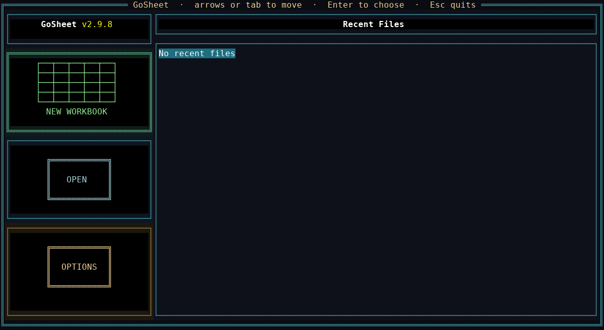

# GoSheet

<div align="center">


**A powerful terminal-based spreadsheet application built with Go**

[Features](#-features) • [Installation](#-installation) • [Usage](#-usage) • [Functions](#-functions) • [File Formats](#-file-formats) • [Contributing](#-contributing)

</div>



---

## 📋 Overview

GoSheet is a feature-rich, lightweight spreadsheet application that runs entirely in your terminal. Built with Go and powered by tview, it offers a modern alternative to traditional spreadsheet software with an emphasis on performance, simplicity, and powerful formula capabilities.

### Why GoSheet?

- **🚀 Fast & Lightweight**: Minimal resource usage with optimized viewport rendering
- **💻 Terminal-Native**: No GUI overhead, works anywhere with a terminal
- **🔧 Powerful Formulas**: 104+ built-in functions for complex calculations
- **📊 Multiple Sheets**: Full workbook support with unlimited sheets
- **🎨 Rich Formatting**: Colors, alignment, text effects, and more
- **💾 Multiple Formats**: Native .gsheet, JSON, Excel (.xlsx), PDF, CSV, HTML, and TXT support
- **⚡ Excel-Like Features**: Data validation, sorting, find/replace, and autofill

---

## ✨ Features

### Core Spreadsheet Features

- **📊 Workbook Management**: Create, rename, duplicate, and reorder sheets
- **🔢 Formula Engine**: 110+ built-in functions, cross-sheet references, circular dependency detection
- **🎨 Cell Formatting**: Bold, italic, underline, strikethrough, colors, alignment
- **📐 Data Types**: String, Number, Financial, DateTime with automatic detection
- **✅ Data Validation**: Excel-like validation rules with custom error messages
- **📝 Cell Comments**: Add notes and annotations to any cell
- **🔍 Find & Replace**: Search with case-sensitive and whole-word options
- **📋 Clipboard Operations**: Cut, copy, paste with format painter
- **↩️ Undo/Redo**: Full history management per sheet
- **🔄 AutoFill**: Smart pattern detection for dates, numbers, and sequences

### Advanced Features

- **🎯 Smart Navigation**: Go-to-cell, keyboard shortcuts, multi-sheet switching
- **📊 Sorting**: Ascending/descending sort with type-aware comparison
- **🔐 Cell Protection**: Mark cells as editable/non-editable
- **🎨 Format Painter**: Copy and paste cell formatting
- **📏 Custom Cell Sizes**: Adjustable min/max widths per cell
- **🔢 Number Formatting**: Customizable thousands/decimal separators, decimal places
- **💰 Financial Formatting**: Currency symbols with full formatting control
- **📅 Date/Time Support**: Multiple format options with auto-detection
- **🚀 Viewport Optimization**: Renders only visible cells for maximum performance
- **📦 Excel Import/Export**: Full .xlsx support with formulas, formatting, and colors

---

## 🚀 Installation

### Prerequisites

- Go 1.24.2 or higher
- Terminal with 256-color support (recommended)

### From Source

```bash
# Clone the repository
git clone https://github.com/drclcomputers/gosheet.git
cd gosheet

# Build the application
go build -o gosheet

# Run GoSheet
./gosheet
```

### Quick Start

```bash
# Create a new spreadsheet
./gosheet

# Open an existing file
./gosheet -file path/to/workbook.gsheet

# Open from start menu
./gosheet
# Then select file from recent files or browse
```

---

## 📖 Usage

### Basic Navigation

### Note: For MacOS users, activating 'Use Option as Meta Key' is mandatory for Alt commands to work. Here is a link "https://superuser.com/questions/1038947/using-the-option-key-properly-on-mac-terminal" for more info.

| Key Combination    | Action                             |
| ------------------ | ---------------------------------- |
| **Arrow Keys**     | Navigate cells                     |
| **Type**           | Replace the selected cell          |
| **F2**             | Edit the cell in the formula bar   |
| **Enter**          | Open the full format dialog        |
| **Delete**         | Clear the selection                |
| **Shift + Arrows** | Select range                       |
| **Escape**         | Save menu / cancel the formula bar |
| **Alt + G**        | Go to cell                         |

### Editing & Clipboard

| Key Combination  | Action         |
| ---------------- | -------------- |
| **Alt + C**      | Copy selection |
| **Alt + V**      | Paste          |
| **Alt + X**      | Cut            |
| **Alt + Delete** | Clear cells    |
| **Alt + Z**      | Undo           |
| **Alt + Y**      | Redo           |

### Formatting

| Key Combination | Action            |
| --------------- | ----------------- |
| **Alt + R**     | Copy cell format  |
| **Alt + I**     | Paste cell format |
| **Alt + N**     | Edit cell comment |

### Sheet Management

| Key Combination    | Action                |
| ------------------ | --------------------- |
| **Alt + M**        | Open Sheet Manager    |
| **Alt + T**        | Quick Sheet Menu      |
| **Alt + PageUp**   | Previous sheet        |
| **Alt + PageDown** | Next sheet            |
| **Alt + 1-9**      | Quick switch to sheet |

### Advanced Operations

| Key Combination | Action             |
| --------------- | ------------------ |
| **Alt + O**     | Sort dialog        |
| **Alt + A**     | AutoFill           |
| **Alt + F**     | Find               |
| **Alt + H**     | Replace            |
| **F3 / F4**     | Find previous/next |
| **Alt + =**     | Insert row/column  |
| **Alt + -**     | Delete row/column  |
| **Alt + /**     | Show help          |

---

## 🧮 Functions

GoSheet includes **104 built-in functions** organized into 22 categories:

### Mathematical Functions (31)

#### Trigonometric (4)

`SIN`, `COS`, `TAN`, `CTAN`

#### Inverse Trigonometric (5)

`ASIN`, `ACOS`, `ATAN`, `ATAN2`, `ACTAN`

#### Additional Trigonometric (4)

`SEC`, `CSEC`, `ASEC`, `ACSC`

#### Degrees/Radians (2)

`RAD`, `DEG`

#### Hyperbolic (4)

`SINH`, `COSH`, `TANH`, `CTANH`

#### Additional Hyperbolic (8)

`SECH`, `CSCH`, `ASINH`, `ACOSH`, `ATANH`, `ASECH`, `ACSCH`, `ACOTH`

#### Exponential/Logarithmic (4)

`EXP`, `LOG`, `LOG10`, `LOG2`

### Power & Basic Math (13)

#### Power/Roots (3)

`SQRT`, `CBRT`, `POW`

#### Basic Math (7)

`ABS`, `CEIL`, `FLOOR`, `ROUND`, `MIN`, `MAX`, `AVG`

#### Utility Math (3)

`SIGN`, `CLAMP`, `LERP`

### Logical Functions (6)

`IF`, `IFS`, `AND`, `OR`, `NOT`, `XOR`

### String Functions (11)

`LEFT`, `RIGHT`, `MID`, `UPPER`, `LOWER`, `PROPER`, `TRIM`, `FIND`, `SUBSTITUTE`, `LEN`, `CONCAT`

### Date/Time Functions (13)

`NOW`, `TODAY`, `DATE`, `TIME`, `YEAR`, `MONTH`, `DAY`, `HOUR`, `MINUTE`, `SECOND`, `WEEKDAY`, `DATEDIFF`, `DATEADD`

### Type Checking (4)

`CHOOSE`, `ISNUMBER`, `ISTEXT`, `ISBLANK`

### Statistical

`COUNT`, `COUNTA`, `COUNTBLANK`, `SUM`, `PRODUCT`, `AVG` / `AVERAGE`

### Lookup (4)

`VLOOKUP`, `HLOOKUP`, `INDEX`, `MATCH`

### Constants (5)

`PI`, `E`, `PHI`, `INF`, `NAN`

### Special Math (6)

`ERF`, `ERFC`, `GAMMA`, `J0`, `J1`, `YN`

### Rounding/Precision (2)

`TRUNC`, `ROUNDTO`

### Engineering (3)

`HYPOT`, `MOD`, `REMAINDER`

### Bitwise Operations (5)

`BITAND`, `BITOR`, `BITXOR`, `BITSHIFTLEFT`, `BITSHIFTRIGHT`

### Additional Math Utility (3)

`FACTORIAL`, `GCD`, `LCM`

### Formula Examples

```excel
# Basic arithmetic. Use = or the legacy $= prefix.
= 10 + 20 * 3
=A1 + B2

# Other sheets. Type the reference, or build it from the formula bar:
# arrows insert the highlighted cell, Alt+PageUp / Alt+PageDown changes sheet.
=Prices!B2
='Q4 Budget'!A1
=SUM(Prices!A1:Prices!B2)

# Lookups
=VLOOKUP("pear", Prices!A1:B2, 2, FALSE)
=INDEX(A1:C10, 2, 3)
=MATCH("pear", A1:A10, 0)
=AVERAGE(A1:A10)
```

```excel
# Cell references
$= A1 + B2

# Functions
$= SUM(A1, B1, C1)
$= IF(A1 > 100, "High", "Low")
$= AVERAGE(A1, A2, A3, A4, A5)

# Nested functions
$= ROUND(AVG(A1, A2, A3), 2)

# Date calculations
$= DATEDIFF(TODAY(), "2024-01-01")

# String manipulation
$= CONCAT(UPPER(A1), " - ", LOWER(B1))

# Complex formulas
$= IF(SUM(A1, A2) > 100, MAX(B1, B2), MIN(C1, C2))

# Cell ranges
$=SUM(A1:A10)           // Single column range
$=SUM(A1:C1)            // Single row range
$=SUM(A1:C10)           // Multi-cell range
$=AVG(B2:B20)           // Works with any function
$=MAX(A1:A5, C1:C5)     // Multiple ranges
$=SUM(A1:A10) + AVG(B1:B10)  // Ranges in expressions

Cell A1: 10
Cell A2: 20
Cell A3: 30
Cell B1: $=SUM(A1:A3)   → Result: 60

Cell C1: 5
Cell C2: 15
Cell C3: 25
Cell D1: $=AVG(A1:A3, C1:C3)  → Result: 17.5
```

---

## 📁 File Formats

### Supported Formats

| Format     | Extension | Read | Write | Description                  |
| ---------- | --------- | ---- | ----- | ---------------------------- |
| **GSheet** | `.gsheet` | ✅   | ✅    | Native format (gzipped JSON) |
| **JSON**   | `.json`   | ✅   | ✅    | Human-readable JSON          |
| **Excel**  | `.xlsx`   | ✅   | ✅    | Microsoft Excel format       |
| **CSV**    | `.csv`    | ✅   | ✅    | Comma-separated values       |
| **PDF**    | `.pdf`    | ❌   | ✅    | Portable Document Format     |
| **TXT**    | `.txt`    | ✅   | ✅    | Tab-delimited text           |
| **HTML**   | `.html`   | ❌   | ✅    | Styled HTML table            |

### Excel Support Notes

**GoSheet provides comprehensive Excel import/export capabilities with the following features:**

**Import Features:**

- ✅ Multiple sheets with names preserved
- ✅ Cell values and formulas (auto-evaluated on load)
- ✅ Text formatting: bold, italic, underline, strikethrough
- ✅ Font colors (RGB/hex)
- ✅ Background colors (including empty cells with formatting)
- ✅ Text alignment (left, center, right)
- ✅ Cell comments and notes
- ✅ Number formats with decimal places
- ✅ Column widths
- ⚠️ Complex Excel-specific formulas may need adjustment
- ❌ Charts, images, pivot tables, macros not supported

**Export Features:**

- ✅ All sheets with original names
- ✅ Formulas (converted to Excel format)
- ✅ All cell formatting preserved
- ✅ Font and background colors
- ✅ Comments and notes
- ✅ Number formatting
- ✅ Column widths
- ✅ Text alignment

**Known Excel Compatibility Notes**

- The @ Symbol Issue
  When opening GoSheet-exported Excel files in newer versions of Excel (2019/365), you may see an @ symbol automatically inserted before some formulas:

```excel
# Original formula in GoSheet
$=SUM(A1:A10)

# How Excel 2019+ may display it
=@SUM(A1:A10)
```

This is normal Excel behavior, not a bug in GoSheet. The @ is Excel's "implicit intersection operator" and doesn't affect functionality. Excel adds it automatically when loading the file. Users can manually remove it if desired, but it's not necessary.

**Formula Conversion**

- Most common functions work identically (SUM, AVG, IF, MAX, MIN, COUNT, etc.)
- GoSheet formulas use **$=** prefix; this is automatically stripped for Excel export
- Some advanced GoSheet-specific functions may not have Excel equivalents
- Cell ranges (A1:A10) are fully compatible

**Tips for Best Compatibility**

- Use standard functions: Stick to common functions like SUM, AVG, IF, MAX, MIN for maximum compatibility
- Test formulas: Always verify complex formulas work in Excel after export
- Colors: **RGB colors** are fully supported and preserved
- Formatting: **Bold**, _italic_, <ins>underline</ins>, and alignment are 100% compatible
- Save as **.gsheet**: Use **native format** for full feature preservation

---

## 🔧 Configuration

### Terminal Requirements

- **Minimum**: 80x24 characters
- **Recommended**: 120x40 or larger
- **Colors**: 256-color support recommended
- **Fonts**: Monospace font required

### Memory Usage

GoSheet uses an optimized viewport system that renders only visible cells:

- **Base Memory**: ~5-10 MB
- **Per 10,000 Cells**: ~2-5 MB additional
- **Viewport Cleanup**: Automatically frees unused cell memory

### Performance Tips

1. **Viewport Size**: Larger terminals show more cells but use more memory
2. **Formula Optimization**: Avoid deeply nested formulas when possible
3. **Data Cleanup**: Delete unused sheets and cells periodically
4. **File Format**: Use `.gsheet` for best performance

---

## 🎨 Data Validation

GoSheet includes Excel-like data validation with 14 preset types:

### Validation Presets

1. **Whole Number - Between**: Value must be integer in range
2. **Whole Number - Greater Than**: Integer greater than value
3. **Whole Number - Less Than**: Integer less than value
4. **Decimal - Between**: Float in range
5. **Decimal - Greater Than**: Float greater than value
6. **Decimal - Less Than**: Float less than value
7. **Text Length - Between**: String length in range
8. **Text Length - Maximum**: String length limit
9. **Text - Not Empty**: Required field
10. **List - Allowed Values**: Dropdown-like validation
11. **Email Format**: Basic email validation
12. **Positive Numbers Only**: Must be > 0
13. **Percentage (0-100)**: Value between 0 and 100
14. **Custom**: Write your own validation expression

### Custom Validation Examples

```excel
# Value must be even
THIS % 2 == 0

# Value must be between 0 and 100
THIS >= 0 && THIS <= 100

# Text must start with "ID-"
FIND("ID-", THIS) == 1

# Must be valid email format
CONTAINS(THIS, "@") && CONTAINS(THIS, ".")
```

---

## 🏗️ Architecture

### Project Structure

```
gosheet/
├── internal/
│   ├── services/
│   │   ├── cell/              # Cell data structures and operations
│   │   ├── fileop/            # File I/O operations and format handlers
│   │   ├── table/             # Table management, sheets, forumula engine and viewport
│   │   └── ui/                # User interface components
│   │       ├── cell/              # Cell editing and formatting UI
│   │       ├── datavalidation/    # Validation rules and dialogs
│   │       ├── file/              # File browser and start menu
│   │       ├── navigation/        # Find, replace, and go-to dialogs
│   │       └── sheetmanager/      # Sheet management UI
│   └── utils/                 # Utility functions
│       └── evaluatefuncs/     # Formula evaluation functions
├── docs/images.               # Demo screenshots and GIFs
├── go.mod
├── go.sum
├── LICENSE.md
├── README.md
└── main.go
```

### Key Components

- **Cell Service**: Manages individual cell data, formatting, and formulas
- **File Service**: Format-agnostic file operations with pluggable handlers (.gsheet, .xlsx, .json, etc.)
- **Table Service**: Viewport management, sheet operations, undo/redo, and memory optimization
- **UI Service**: Dialogs, menus, and user interactions
- **Formula Engine**: Expression evaluation engine with 104 built-in functions and circular dependency detection
- **Utils**: Helper functions for colors, date/time, formatting, and column naming

---

## 🤝 Contributing

**Contributions are welcome! Here's how you can help make GoSheet better:**

### Ways to Contribute

- **🐛 Report bugs and issues**
- 💡 Suggest new features
- 📖 Improve documentation
- **🔧 Submit bug fixes**
- ✨ Add new features
- 🧪 Write tests

### Reporting Issues

**When reporting issues, please include:**

- GoSheet version (visible in start menu)
- Operating system and terminal emulator
- Steps to reproduce the issue
- Expected vs actual behavior
- Screenshots if applicable

### Pull Requests

1. Fork the repository
2. Create a feature branch: git checkout -b feature/amazing-feature
3. Make your changes with clear, atomic commits
4. Add tests for new functionality
5. Update documentation (README, code comments)
6. Ensure code follows Go conventions
7. Test thoroughly on your platform
8. Push to your fork: git push origin feature/amazing-feature
9. Open a Pull Request with clear description

### Development Guidelines

- Code Style: Follow standard Go formatting (gofmt, golint)
- Comments: Add clear comments for complex logic
- Testing: Include unit tests for new functions
- Documentation: Update README for user-facing changes
- Commits: Write descriptive commit messages

### Areas for Contribution

**Some areas where contributions would be especially valuable:**

- 📊 Chart and graphing support
- 🎨 Conditional formatting
- 📈 Pivot table functionality
- 🔌 Plugin system architecture

---

## 📄 License

This project is licensed under the MIT License - see the [LICENSE.md](LICENSE.md) file for details.

```
MIT License

Copyright (c) 2025 drclcomputers

Permission is hereby granted, free of charge, to any person obtaining a copy
of this software and associated documentation files (the "Software"), to deal
in the Software without restriction, including without limitation the rights
to use, copy, modify, merge, publish, distribute, sublicense, and/or sell
copies of the Software, and to permit persons to whom the Software is
furnished to do so, subject to the following conditions:

The above copyright notice and this permission notice shall be included in all
copies or substantial portions of the Software.

THE SOFTWARE IS PROVIDED "AS IS", WITHOUT WARRANTY OF ANY KIND, EXPRESS OR
IMPLIED, INCLUDING BUT NOT LIMITED TO THE WARRANTIES OF MERCHANTABILITY,
FITNESS FOR A PARTICULAR PURPOSE AND NONINFRINGEMENT.
```

---

## 🙏 Acknowledgments

### Dependencies

- [tview](https://github.com/rivo/tview) - Terminal UI framework
- [tcell](https://github.com/gdamore/tcell) - Terminal handling
- [expr](https://github.com/expr-lang/expr) - Expression evaluation
- [excelize](https://github.com/xuri/excelize) - Excel file format library
- [gopdf]("github.com/jung-kurt/gofpdf") - PDF file format library
- [go-ods](https://github.com/AlexJarrah/go-ods) - ODS file format library
- [golang.org/x/term](https://golang.org/x/term) - Terminal utilities
- [golang.org/x/text](https://golang.org/x/text) - Text processing

### Inspiration

GoSheet was inspired by:

- VisiCalc (1979) - The original spreadsheet program
- Lotus 1-2-3 (1983) - Revolutionary spreadsheet software
- sc - Classic terminal spreadsheet calculator and its succesor sc-im
- Microsoft Excel - Modern spreadsheet features and UX
- LibreOffice Calc - Open-source spreadsheet alternative
- Google Sheets - Cloud-based collaboration features

---

## 📊 Project Stats

- **Lines of Code**: ~15,000+
- **Functions**: 104 built-in
- **File Formats**: 6 supported
- **Go Version**: 1.24.2
- **Started**: October 2025
- **Status**: Active Development
- **License**: MIT

---

## 🗺️ Roadmap

- [x] Excel file format support (.xlsx)
- [ ] Charts and graphs
- [ ] Conditional formatting
- [ ] Pivot tables
- [ ] Macro recording
- [ ] Plugin system
- [x] More export formats (PDF)
- [ ] Autobackup (auto save file to %APPDATA%/.gsheet)
- [ ] Templates
- [x] Printing - Note: There is no built-in print dialog. You can export the sheet as a pdf and print it using the native command/dialog of your operating system
- [ ] Data protection
- [x] Multi-sheet workbooks
- [x] Data validation
- [x] Advanced formula engine
- [x] Format painter
- [x] AutoFill

---

## 💬 Support

- **Issues**: [GitHub Issues](https://github.com/drclcomputers/gosheet/issues)
- **Discussions**: [GitHub Discussions](https://github.com/drclcomputers/gosheet/discussions)

---

## 🌟 Star History

If you find GoSheet useful, please consider giving it a star on GitHub!

---

<div align="center">

**Built with ❤️ using Go**

[⬆ Back to Top](#gosheet)

</div>
